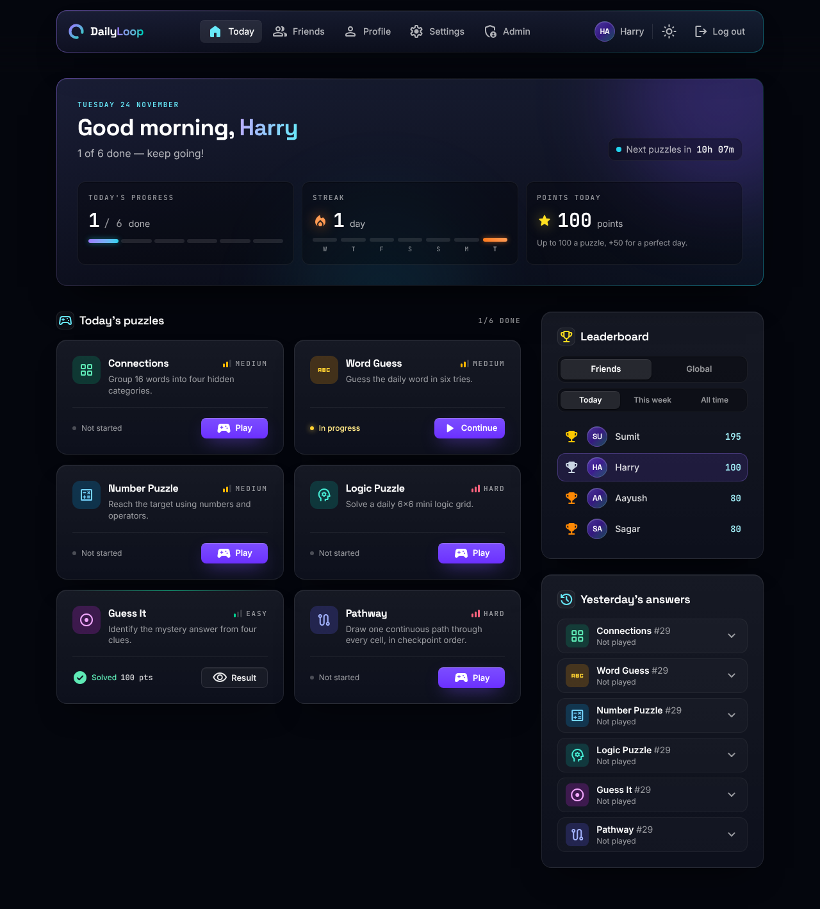
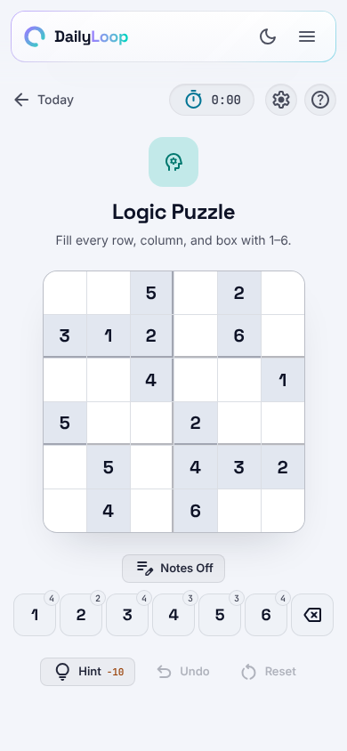
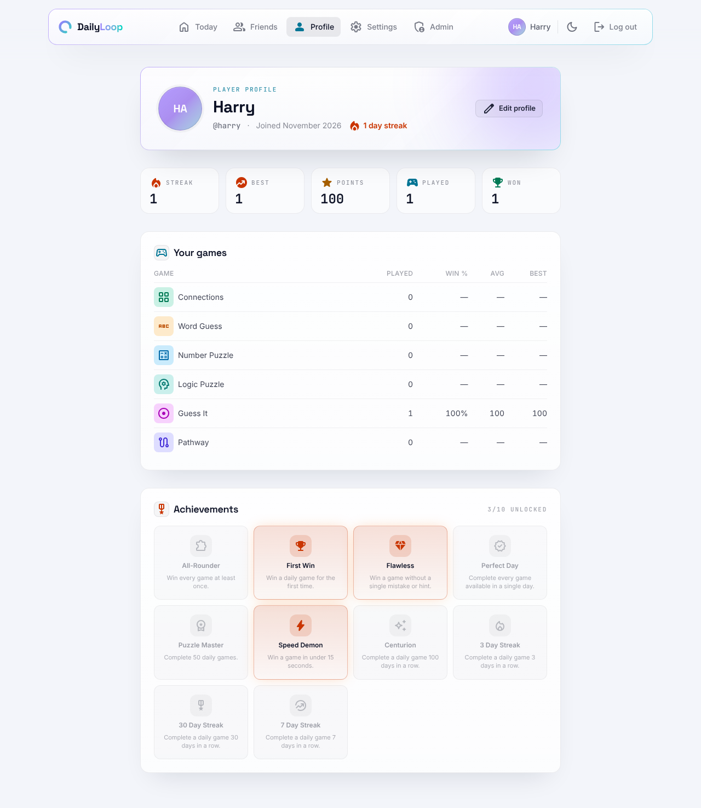
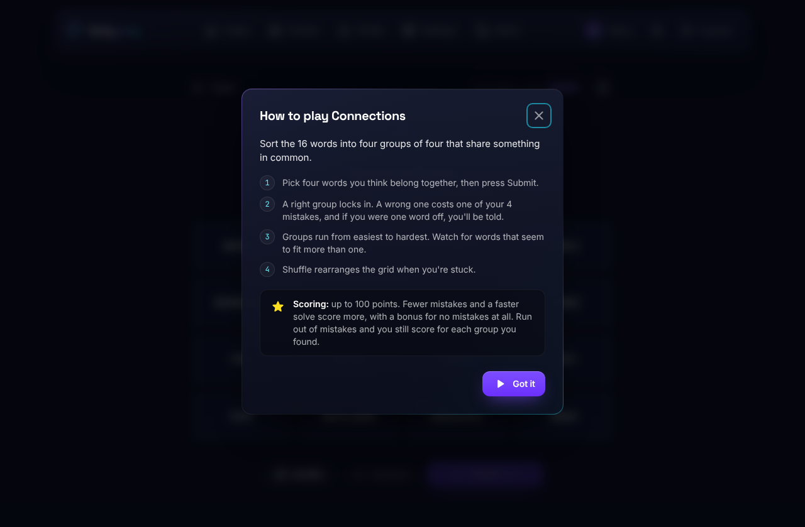

# DailyLoop

New puzzles every day. Play a few minutes. Beat your friends.

DailyLoop is a daily puzzle platform: every user gets the same puzzle for each game on a given
day, and can track streaks, compare scores, and climb a friends leaderboard. It's built as a
modular game platform — new games plug into a shared engine, scoring system, and daily-puzzle
scheduler without touching core code.

> **Status:** all 6 games, scoring/streaks/achievements, friends, and the admin panel are built
> and tested. See [docs/architecture.md](docs/architecture.md) for the full build log and the
> architectural decisions behind it, and [docs/deployment.md](docs/deployment.md) to ship it.

<p>
  
  
</p>
<p>
  
  
</p>

<sub>These are the visual-test baselines (see <a href="apps/web/visual">apps/web/visual</a>), so they always
show the current UI.</sub>

## Games

| Game          | What you do                                                             | Difficulty             |
| ------------- | ----------------------------------------------------------------------- | ---------------------- |
| Connections   | Sort 16 words into four hidden groups (one per colour, yellow → purple) | Fixed bank, 115 groups |
| Word Guess    | Guess the five-letter word in six tries                                 | Curated answers        |
| Number Puzzle | Combine four numbers with + − × ÷ to hit the target                     | Ramps through the week |
| Logic Puzzle  | A 6×6 Sudoku — always uniquely solvable without guessing                | Ramps through the week |
| Guess It      | Name the mystery answer from up to four clues                           | Fixed bank, 94 entries |
| Pathway       | Draw one line through every cell, in number order — always one solution | 5×5 → 7×7 through week |

Procedural games follow a weekly curve: Monday/Tuesday easy, Wednesday/Thursday medium,
Friday–Sunday hard. Logic Puzzle and Pathway offer hints, which cost points.

## Tech stack

- **Frontend:** React 19, TypeScript, Vite, Tailwind CSS v4, React Router, TanStack Query
- **Backend:** Node.js, TypeScript, Fastify, Zod, Prisma
- **Database:** PostgreSQL
- **Auth:** server-side sessions (opaque cookie token, hashed in the DB), Argon2 password hashing
- **Testing:** Vitest, React Testing Library, Fastify integration tests; Playwright for screenshot,
  accessibility (axe-core) and end-to-end tests

## Project structure

```
dailyloop/
├── apps/
│   ├── web/            React app (Vite)
│   └── api/             Fastify API
├── packages/
│   ├── shared/           Zod schemas, DTO types, date/timezone utils — used by both apps
│   ├── game-engine/       DailyGame interface, per-game modules, scoring, seeded RNG
│   └── config/            Shared tsconfig/eslint/prettier base config
├── prisma/                schema.prisma, migrations, seed.ts
├── docs/                  architecture & deployment notes
└── docker-compose.yml     local Postgres (+ a disposable Postgres for tests)
```

`packages/shared` and `packages/game-engine` ship as plain TypeScript source (no build step) —
both consumers (`tsx` for the API, Vite for the web app) transpile on the fly, so there's nothing
to rebuild when you change them.

## Prerequisites

- Node.js 22.9+ (see `.nvmrc`; Node 20 is end-of-life)
- Docker (for local Postgres) — or point `DATABASE_URL` at your own Postgres 14+ instance

## Getting started

```bash
npm install
cp .env.example .env        # already done if you're reading this from a fresh clone you set up
npm run db:up                 # starts Postgres (+ a separate disposable Postgres for tests)
npm run db:migrate             # creates the database schema
npm run db:seed                 # creates the admin + demo users below
npm run dev                      # starts the API on :4000 and the web app on :5173
```

Then open http://localhost:5173.

## Dev credentials

Created by `npm run db:seed`. **Fake, local-only credentials — never reuse these anywhere real.**

| Role  | Username | Email                  | Password       |
| ----- | -------- | ---------------------- | -------------- |
| Admin | `admin`  | `admin@dailyloop.dev`  | `DevAdmin123!` |
| Demo  | `harry`  | `harry@dailyloop.dev`  | `DemoPass123!` |
| Demo  | `sumit`  | `sumit@dailyloop.dev`  | `DemoPass123!` |
| Demo  | `aayush` | `aayush@dailyloop.dev` | `DemoPass123!` |
| Demo  | `sagar`  | `sagar@dailyloop.dev`  | `DemoPass123!` |

The four demo users are already friends with each other so the friends leaderboard isn't empty
on first login. With `NODE_ENV=production` the seed skips these accounts entirely and creates your
admin from `ADMIN_EMAIL` / `ADMIN_USERNAME` / `ADMIN_PASSWORD` instead — see
[docs/deployment.md](docs/deployment.md).

## Environment variables

See [.env.example](.env.example) for the full list with comments. One `.env` file at the repo
root is shared by both apps (the API loads it explicitly; Vite is configured to read from the
repo root instead of `apps/web/`).

## Scripts

Run from the repo root:

| Command                                    | What it does                                                      |
| ------------------------------------------ | ----------------------------------------------------------------- |
| `npm run dev`                              | Runs the API and web app together                                 |
| `npm run build`                            | Builds the web app for production                                 |
| `npm run typecheck`                        | Type-checks every package                                         |
| `npm run lint` / `format` / `format:check` | ESLint / Prettier (write / check) across the repo                 |
| `npm test`                                 | Runs all test suites (needs the DB containers up + migrated)      |
| `npm run test:visual -w @dailyloop/web`    | Screenshot regression tests, no DB needed (see apps/web/visual)   |
| `npm run test:e2e -w @dailyloop/web`       | End-to-end journey against the real API and DB (see apps/web/e2e) |
| `npm run db:up` / `db:down`                | Start/stop local Postgres (dev + test)                            |
| `npm run db:migrate`                       | Create & apply a dev migration                                    |
| `npm run db:studio`                        | Open Prisma Studio                                                |
| `npm run db:seed`                          | (Re-)seed dev data                                                |

## Testing

Integration tests hit a **separate, disposable** Postgres container (`postgres_test`, started by
`npm run db:up`) so they never touch your dev data:

```bash
npm run db:up
npm run db:test:migrate   # once, or after a schema change
npm test
```

In a real browser (Playwright, against the production build):

- **Screens and accessibility** (`npm run test:visual -w @dailyloop/web`): every screen in four
  variants (desktop/phone × dark/light), compared pixel by pixel with committed baselines and
  checked with axe-core against WCAG 2.1 AA. The API is replayed from recorded fixtures, so no
  database is needed. See [apps/web/visual](apps/web/visual/README.md).
- **End to end** (`npm run test:e2e -w @dailyloop/web`): sign up, play a game and see it on
  the leaderboard, against the real API and database. See [apps/web/e2e](apps/web/e2e/README.md).

Every push and pull request runs all of it in GitHub Actions (`.github/workflows/ci.yml`): lint,
format, typecheck, the unit and integration suites against a Postgres service, the production web
build, and a browser job with the Playwright suites.

## Deployment

See [docs/deployment.md](docs/deployment.md) for environment variables, build/start commands,
migration steps, and a pre-launch checklist.
